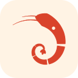

<p align="center">
  
</p>

<h1 align="center">posture-check</h1>

posture-check watches your posture with a webcam. It shows a desktop notification when you slouch or lean toward the screen. It also reminds you to take a break.

The app runs on your computer. It does not save images. It does not send data over the network.

Tested on Fedora with GNOME on Wayland.

## Requirements

- A webcam
- `notify-send` (package `libnotify`)
- `pw-play` (package `pipewire-utils`)
- [uv](https://docs.astral.sh/uv/)

## Start

1. Run `uv run posture.py`. The first run downloads the dependencies.
2. Sit straight when the window shows the countdown.
3. Stay still for 3 more seconds.

The app saves the result in `~/.config/posture-check/profile.json`. Later runs use this file.

Put the camera in front of you or up to about 45 degrees to the side. To use another camera, run `uv run posture.py --camera 1`.

## The window

The window is 960 by 640 pixels. You can resize it. The design follows [posture-check by enkr1](https://github.com/enkr1/posture-check).

```
+---------------------+-----------+
| A  camera           | B  today  |
|                     |    log    |
+---------------------+-----------+
| C  controls                     |
+---------------------------------+
```

**A, the camera.** The picture is a mirror image. It shows a line for your shoulders and one dot for your head. A dashed line joins them. This is what the app measures.

- A frame, the line and the dot share one color. Green means OK. Yellow means a problem started and no nag has fired yet. Red means the app sent a nag. A thick red frame means a nag is active.
- The app ignores a frame when it cannot see the nose or a shoulder well. The picture then names the point it cannot see.
- A large number counts down during the calibration.
- The scanlines and the dark corners are for the look. Set `CRT = False` to remove them. Set `MIRROR = False` for a picture that is not a mirror image.

**B, the day.** TODAY shows the number of episodes, the bad time, the average length and the busiest hour. An episode is bad posture that lasted 20 seconds or more. LOG lists the episodes with the newest first. It also lists breaks, snoozes, pauses, times away and calibrations. The log panel reads the rows of today from the log file at start. Each episode has an outcome:

| Outcome | Meaning |
|---------|---------|
| FIXED | You sat straight within 30 seconds of the first nag. |
| SLOW | You sat straight, but later. No second nag came. |
| IGNORED | A second nag came before you sat straight. |

**C, the controls.** The left side shows the state. Each number has a bar. The red zone is a problem. The yellow zone is the band where a state that already started stays. The green zone is OK. The thin line is your baseline. The white mark is the live value. The buttons work like the keys below. A green border means a toggle is on. A line through the name means it is off. The timeline shows the last 30 minutes. Green is OK. Yellow is a problem before the nag. Red is a problem after the nag. Grey is away or paused. A tick marks every 10 minutes. "aligned" is the share of OK time. Away and paused time do not count.

## Keys

Click a button, or click the window and press a key.

| Key | Action |
|-----|--------|
| `c` | Calibrate again. Do this after you move the camera or the chair. |
| `p` | Pause or resume. |
| `s` | Snooze for 5 minutes. The app starts again by itself. Press `s` or `p` again to start earlier. |
| `m` | Mute or unmute the sounds. The notifications stay on. |
| `n` | Hide or show the notifications. The sounds stay on. |
| `f` | Flip the picture. |
| `q` | Quit. |

## How it works

The app compares your head with the profile. It uses two numbers:

- **Head height**: the distance from the head to the shoulders. This number gets smaller when you slouch.
- **Lean in**: how far the head moves toward the screen.

The app ignores a frame when it cannot see the nose or a shoulder well. After 10 seconds without a person, the state is **away**.

When a number passes its limit, the app starts a timer. After 20 seconds, you get a notification. The notification names the problem and gives one tip. The app repeats it every 2 minutes until you sit straight.

A problem ends only when its number is well back inside the limit. Head height must rise above `SLOUCH_EXIT`. The lean must fall below `LEAN_EXIT`. This stops the state from flickering when your posture is close to a limit.

The limits and times are constants at the top of `posture.py`. The main ones are `SLOUCH`, `LEAN`, `GRACE`, `REPEAT`, `DOWN_DELAY` and `UP_DELAY`. The bars in the window show the live numbers and the limits.

## Breaks

The app counts how long you sit. After 30 minutes, you get a break notification. The app repeats it every 5 minutes until you stand up.

A time away from the camera counts as a break after 1 minute. The app first needs 10 seconds to see that you left. The count then starts again. The window shows how long you have been sitting.

The times are `BREAK_AFTER`, `BREAK_REPEAT` and `BREAK_AWAY`.

## Sound

The app plays three sounds with `pw-play`.

- `winding_down.wav` plays when your posture has been bad for 2 seconds.
- `four_clicks.wav` plays with each notification.
- `ratchet_up.wav` plays when your posture has been good for 0.5 seconds. It plays only after `winding_down.wav` played.

Press `m` to mute the sounds. To change a sound, edit `sounds/synth.py`. Then run `python3 sounds/synth.py`.

## Log

The app writes events to `~/.local/share/posture-check/log.csv`. The columns are `timestamp`, `event` and `detail`.

The events are `start`, `stop`, `calibrate`, `pause`, `snooze`, `resume`, `away`, `back`, `bad_start`, `bad_end`, `nag` and `break`.

- A `bad_start` row appears when bad posture begins. To ignore short dips, keep only the `bad_start` and `bad_end` pairs that last 20 seconds or more.
- A `nag` row appears when a nag is due, also when the notifications are off. The detail is the problem.
- A `break` row appears with each break notification. The detail is the number of seconds you sat.
- A `snooze` row works like a `pause` row. It ends at the next `resume` row.

If an interval is still open at `stop`, it ends at the `stop` row.

## Errors

The app shows a start error or a lost camera as a notification, because the menu launcher has no terminal. If the camera stops, the app opens it again. After 30 seconds without a picture, the app stops.

## Test

Run `python3 tests/test_posture.py`. The test needs no install.

## Desktop integration

To start the app from the application menu, save this as `~/.local/share/applications/posture-check.desktop`:

```ini
[Desktop Entry]
Type=Application
Name=Posture Check
Comment=Webcam posture reminder
Exec=<UV> run <REPO>/posture.py
Path=<REPO>
Icon=<REPO>/icon/posture-check.svg
Terminal=false
Categories=Utility;
Keywords=posture;webcam;health;
```

Replace `<UV>` with the full path of `uv` (run `which uv`). Replace `<REPO>` with the full path of the `posture-check` folder. Use full paths. The file does not expand `~` or `$HOME`.

Then run `update-desktop-database ~/.local/share/applications`. If "Posture Check" does not show in the menu, log out and in again.

## Versions

Run `uv run posture.py --version` to see the version. [CHANGELOG.md](CHANGELOG.md) lists the changes of each version.

## Plans

See [DEVEL-TODO.md](DEVEL-TODO.md).

## License

MIT. See [LICENSE](LICENSE). The model file keeps its own license (Apache 2.0).

## Credits

The pose model is `pose_landmarker_lite` from [MediaPipe](https://github.com/google-ai-edge/mediapipe) by Google (Apache 2.0).

Several ideas come from other posture projects. No code is copied. The projects are [PosturePilot](https://github.com/reeyabansal/PosturePilot) (hysteresis, break reminders, snooze), [posture-check by enkr1](https://github.com/enkr1/posture-check) (visibility check) and [AI-Posture-Monitor](https://github.com/TheCodingFarm/AI-Posture-Monitor) (camera choice).
